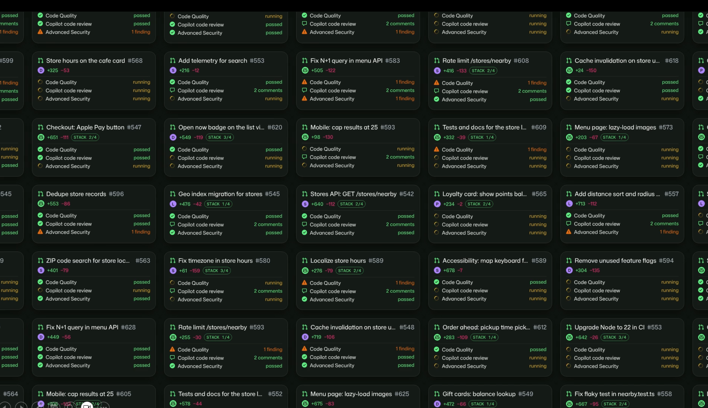

# The volume problem

{ .slide loading=lazy }

Checks run on every one of these pull requests at once.

## Details

- Each card shows the three checks and their state: passed, running or a finding.
