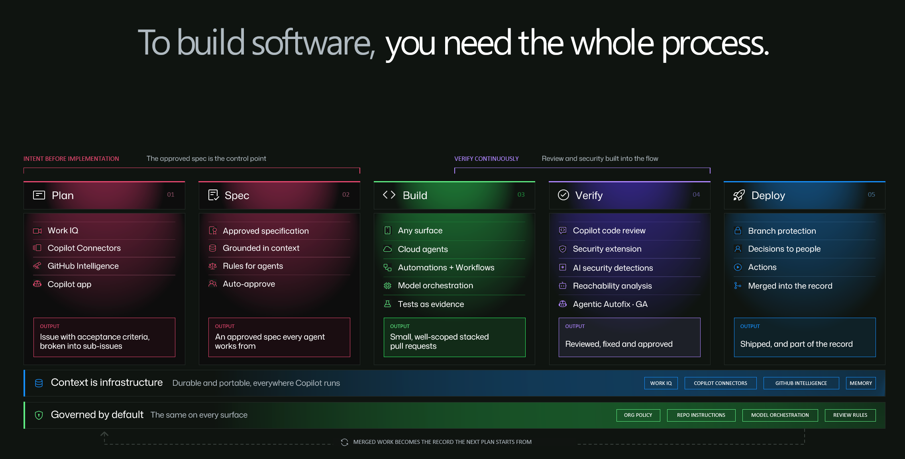

# To build software, you need the whole process

{ .slide loading=lazy }

Intent before implementation, then verify continuously.

## Details

- **Plan:** Work IQ, Copilot Connectors, GitHub Intelligence, Copilot app. Output: an issue with acceptance criteria, broken into sub-issues.
- **Spec:** approved specification, grounded in context, rules for agents, auto-approve. Output: an approved spec every agent works from.
- **Build:** any surface, cloud agents, automations and workflows, model orchestration, tests as evidence. Output: small, well-scoped stacked pull requests.
- **Verify:** Copilot code review, security extension, AI security detections, reachability analysis, Agentic Autofix (GA). Output: reviewed, fixed and approved.
- **Deploy:** branch protection, decisions to people, Actions, merged into the record. Output: shipped, and part of the record.
- **Context is infrastructure** and work is **governed by default** on every surface.
