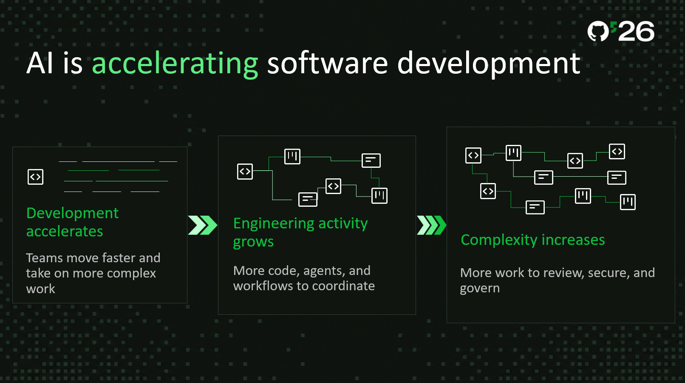
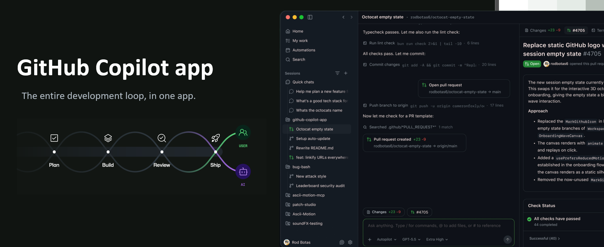
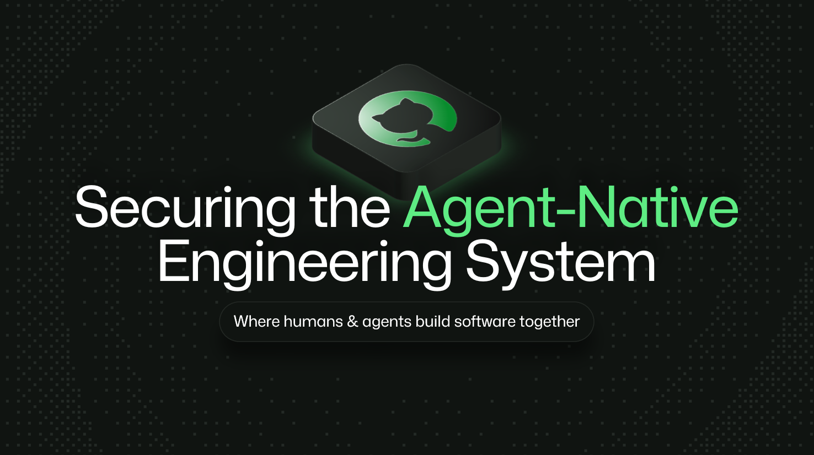
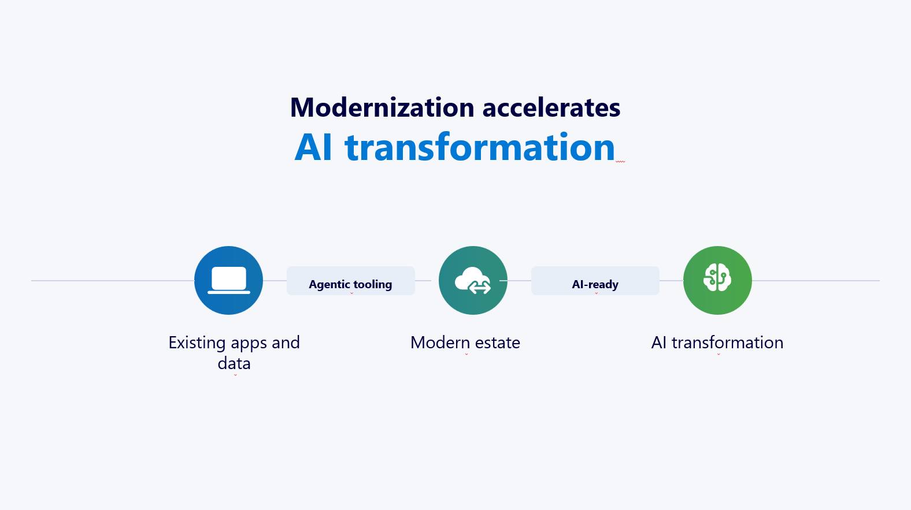
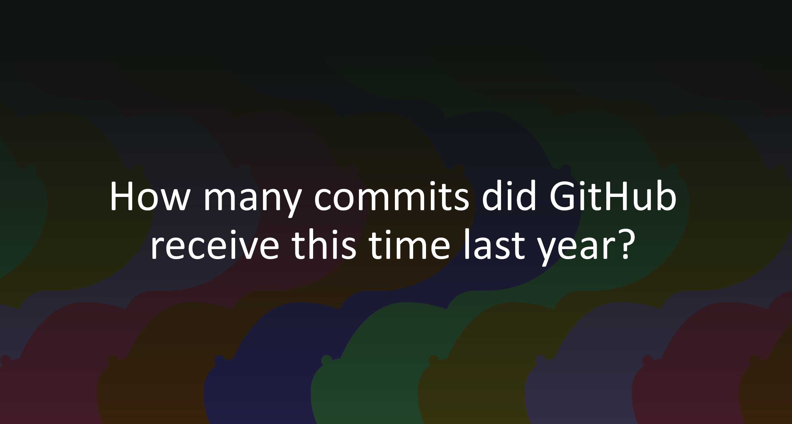

# Developer Day November 2026

Welcome to Developer Day November 2026.

<a class="chapter-card" href="chapter-1/">

<strong>1. GitHub Universe TLDR</strong>
The GitHub Universe highlights in eight slides.
</a>

<a class="chapter-card" href="chapter-2/">

<strong>2. GitHub Copilot Chat, GitHub Copilot App and Coding and Review Agents</strong>
Slides on managing agents and everything in flight.
</a>

<a class="chapter-card" href="chapter-3/">

<strong>3. Secure Delivery with GitHub Advanced Security</strong>
Securing the agent-native engineering system, nine slides.
</a>

<a class="chapter-card" href="chapter-4/">

<strong>4. App Modernisation with GitHub Copilot</strong>
Modernizing apps to unlock AI transformation, eight slides plus a CLI guide.
</a>

<a class="chapter-card" href="chapter-5/">

<strong>5. Agentic Engineering past the pilot</strong>
Verification, governance and scale, with 22 slides and two video clips.
</a>

Use the sun and moon button in the header to switch between light and dark mode.
